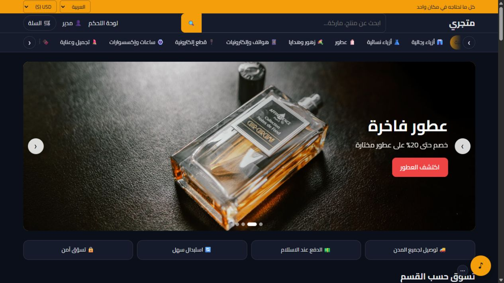

<div dir="rtl">

# متجري — Matjari

[](https://github.com/devhaider8354/Matjari/actions/workflows/build.yml)

[English](README.md) | **العربية**

متجر إلكتروني بواجهة عربية وإنجليزية، والدفع عند الاستلام، ولوحة لإدارة المنتجات والطلبات والمحتوى. مبني باستخدام Next.js وReact وMongoDB.

**[عرض المتجر التجريبي](https://store-demo.byhdr.com)**



## المميزات

- واجهة بلغتين مع دعم الاتجاه من اليمين لليسار والبحث والتصفية والأقسام المتفرعة.
- منتجات بصور متعددة وفيديو ومتغيرات لكل منها سعر ومخزون وصورة.
- سلة، وطلبات للزائر أو بحساب، وتتبع الطلب، والدفع عند الاستلام.
- لوحة للمنتجات والأقسام والطلبات والزبائن والإعدادات والعملات.
- وصولات قابلة للتخصيص والطباعة والتصدير إلى PDF بمقاسات A4 وA5 والحراري.
- سلايدر وثيم ومدونة وموسيقى اختيارية وتطبيق ويب قابل للتثبيت على HTTPS.
- إعدادات SEO وخريطة موقع وخلاصة Google Merchant وإشعارات بريد وتيليجرام اختيارية.
- صلاحيات للفريق والتحقق بخطوتين وسجل نشاط وحدود لمحاولات الدخول.

## التشغيل محلياً

المتطلبات: Node.js 22 وnpm وقاعدة MongoDB. Redis اختياري.

<div dir="ltr">

```bash
git clone https://github.com/devhaider8354/Matjari.git
cd Matjari
npm ci
cp .env.example .env.local
node -e "console.log(require('crypto').randomBytes(48).toString('hex'))"
```

</div>

اضبط `MONGODB_URI` واختر `ADMIN_PATH`، وانسخ ناتج الأمر الأخير إلى `JWT_SECRET` في ملف البيئة، ثم أنشئ حسابك وشغّل التطبيق:

<div dir="ltr">

```bash
npm run create-admin -- owner@example.com "Store owner"
npm run dev
```

</div>

أمر إنشاء المدير يولّد كلمة مرور ويطبعها للمشغّل؛ احفظها بعيداً عن Git. لا توجد بيانات دخول جاهزة مضمّنة بالمصدر. يمكن بدلاً من الأمر ضبط `DEFAULT_ADMIN_EMAIL` و`DEFAULT_ADMIN_PASSWORD` محلياً لإنشاء أول مدير عند الدخول.

المتجر على `http://localhost:3000`، ولوحة الإدارة على المسار المختار في `ADMIN_PATH` متبوعاً بـ`/login`.

## البيانات والصور

`npm run seed` ينشئ كتالوجاً تجريبياً عندما تكون قاعدة البيانات فارغة. الصور تبقى داخل `uploads/` ولا تُضاف إلى Git. جلب الصور الخارجية اختياري ويحتاج مفتاح Pexels خاصاً بك. لا يتضمن المستودع نسخة قاعدة بيانات الديمو أو ملفاته المرفوعة.

## وضع العرض

الإعداد `DEMO_MODE=false` هو الافتراضي. في نسخة عرض معزولة، فعّله واضبط حساب العرض في ملف البيئة:

- تُمنع تغييرات بريد حساب العرض وكلمة مروره وإعدادات التحقق بخطوتين والاستعادة.
- تُمنع إضافة المدراء وتعديل حسابات المدراء من الواجهة البرمجية.
- تُحجب صفحة الفريق ويُخفى رابطها، بينما تعمل إدارة المنتجات والمحتوى.

وضع العرض ليس عزلاً كاملاً للعمليات؛ استخدم بيانات ووسائط تجريبية منفصلة ولا تستخدم بيانات دخوله في متجر حقيقي.

## البناء والنشر

<div dir="ltr">

```bash
npm test
npm run check:public
npm run build
npm start
```

</div>

راجع [BUILD.md](BUILD.md) للبناء والفحوص و[DEPLOY.ar.md](DEPLOY.ar.md) للنشر على Node.js خلف Nginx.

## بنية المشروع

<div dir="ltr">

```text
app/          storefront, admin pages and API routes
components/   store and administration UI
lib/          sessions, permissions, demo policy, mail and caching
models/       MongoDB schemas
scripts/      administrator setup and optional sample catalog
tests/        demo account and team policy checks
public/       static service-worker assets
uploads/      runtime media; ignored by Git
```

</div>

## الخصوصية والأسرار

ملفات البيئة والمفاتيح وكلمات المرور ونسخ قاعدة البيانات والوسائط مستثناة من النشر. ملف `.env.example` يوضح أسماء الإعدادات فقط. راجع [SECURITY.md](SECURITY.md).

## الترخيص

[MIT](LICENSE) © 2026 FLOW POINT — تطوير حيدر ([flowp.uk](https://flowp.uk)). للمكتبات الخارجية تراخيصها الخاصة؛ الوسائط ليست جزءاً من ترخيص الكود.

</div>
